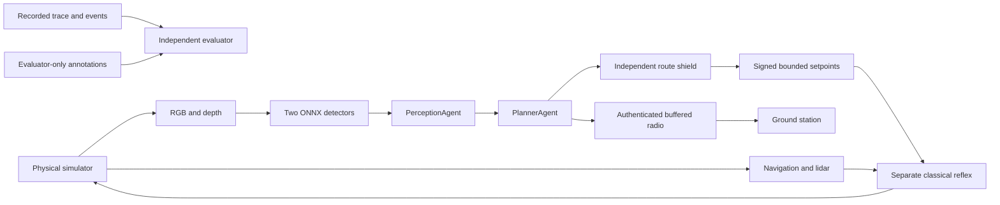

# SKYFORGE — project, engineering and presentation guide

Humanitarian autonomous drone for Dronathon3.0, IEEE RAS & AESS ENSIT.
The official [specification](dronathon.pdf) takes precedence over our choices.
Repository: https://github.com/drakedeveloper/dronathon

## 1. Readiness and evidence

SKYFORGE combines a native AirSim rescue mission, two deterministic agents,
a separate classical reflex, authenticated radio and a live tactical station.

**Start here:** double-click **START-DEMO.bat**, then open
**http://127.0.0.1:8768**. Keep the terminal open. Use **START-SKYFORGE.bat**
for the performance profile without the extra observer camera.
Use **START-VISIBLE-DEMO.bat** to open the separate AirSim window and follow
the aircraft, alongside the dashboard. **STOP-SKYFORGE.bat** immediately closes
the local simulator and its mission services, even during flight. This aborts
the current simulated run. Every native Start launcher first clears the previous
owned demo processes, then launches a fresh instance. Unrelated applications are left open.
Use **START-QUALITY-DEMO.bat** for the optional 1600x900 visual profile, capped at
60 FPS with a 1400 MB texture pool, 2048-pixel shadow maps, contact shadows,
8x anisotropic filtering, restrained bloom and adjusted midtone contrast.
It keeps flight logic, physics and detector camera dimensions unchanged. Rendering
can affect image appearance and timing; use the original performance launcher
for timing comparisons. Quality settings follow [Epic's scalability reference](https://dev.epicgames.com/documentation/en-us/unreal-engine/scalability-reference-for-unreal-engine).

The editable presentation and videos are under `deliverables/`:
`SKYFORGE-PITCH-EDGE.pptx`, `SKYFORGE-full-mission.mp4` and
`SKYFORGE-pitch-edited.mp4`. The main deck is timed for ten minutes, including
six flight chapters totalling 90 seconds and a 32.5-second objective/radio
controls demonstration. Click each video in slideshow mode. Three additional
slides are backup. All presentation
phase labels are English. Speaker notes contain explanations and sources.
The mechanical-design slide shows the Holybro X500 V2 product reference,
credited to Holybro, alongside our separate simulation mass and CG assumptions.

| Acceptance gate | Recorded result |
|---|---|
| Native rescue | native-676ca0dd: 3/3 virtual deliveries, return and grounded disarm in 159.7 s |
| Flight geometry | Zero declared hazard entries, static collision segments or recorded contacts |
| Delivery position errors | 6.2 cm, 6.7 cm and 2.3 cm |
| Energy | 9.10 Wh remaining from a declared 20 Wh mission allowance |
| Frozen primary vision | mAP50 99.2% on 100 unseen scene views |
| Frozen secondary vision | mAP50 95.8%; injured-person recall 85.7% at the selected threshold |
| Radio/security | All six live outage/corruption/replay campaign checks passed |
| Software timing | Performance run: 131.9 ms camera-request-to-command-dispatch p95 |
| Simulator completion timing | The stricter camera-request-to-RPC-completion bound was 153.5 ms, slightly above 150 ms; reported separately from software dispatch |
| Native package | Cooked Windows runtime launched and completed the recorded mission |
| ROS2 deployment | Docker image built; 87 tests passed inside the image |
| Hardware / real photos | Separate future integration scope; simulation results are identified by domain |

Selected reports are in `validation/`. Full traces, raw camera frames and
recorded telemetry are retained locally under ignored `artifacts/`.

## 2. Brief, scoring and design choices

Explore a coastal area; map litter, mines and weapons; detect injured people
and hostile units; prioritize feasible medical aid; avoid obstacles and danger;
deliver simulated supplies; survive radio loss; return with reserve.

This is humanitarian. Weapons/mines are inert detection/avoidance props. Hostile
units are exclusion zones. Nothing is targeted or attacked. A real photograph
of a human is not automatically an injury or hostility label.

The PDF requires exactly two deterministic LangGraph nodes, PerceptionAgent
and PlannerAgent, without LLM calls in the real-time loop. Reflex and radio are
ordinary deterministic components, not additional agents.

| Timing requirement | Limit |
|---|---:|
| Classical reflex |<50 ms|
| Deliberative decision |≤100 ms|
| End-to-end p95 |≤150 ms|

Communication: compact JSON under1 KB, version/sequence fields, declared ring
buffer and replay/resynchronization. Deliver source, deployable3D scene,
technical explanation, live demonstration and oral presentation. Raspberry Pi
deployment is bonus. Waste is detected/mapped; waste collection is not required.

Scoring: autonomy20%, intelligence20%, navigation15%, communication/resilience15%,
adaptability15%, efficiency15%. Collision, danger entry, wrong delivery and failed
return are penalty/failure conditions; exact penalty numbers were not supplied.

The brief describes a jury-supplied primary detector, scenario and station, but
the team received only three links and simulator freedom. We implemented
replacements with adapter boundaries. Disclose this interpretation to the jury.

Chosen tools: Python, LangGraph, OpenCV, ONNX Runtime; Cosys-AirSim/Unreal for
native visuals and physical flight; preserved ROS2 Jazzy/Gazebo Harmonic fallback.
FreeRTOS is unnecessary for these desktop processes. SITL means actual autopilot
firmware running on a computer: ArduPilot heartbeat was checked, but SITL is not
driving this mission. AirSim uses SimpleFlight; Gazebo uses its physical
multicopter controller. Do not claim PX4/ArduPilot integration from installation.

## 3. Architecture



Native launcher starts station, weather/moving-prop driver, reflex and mission
as separate processes. The mission has a camera/inference worker. Camera,
navigation and motion have separate RPC sockets. Timestamp-aligned odometry
comes from the reflex history rather than two extra RPCs around every image.

Navigation truth/depth are declared simulator sensor inputs: there is no claimed
real-world SLAM or visual-inertial estimator. Agents consume only the mission
section of scene configuration. Exact entity annotations belong to offline
training/evaluation. Distress beacons and prior static obstacles are explicit
mission inputs. Beacons alone never authorize delivery.

Planning coordinates are ENU metres and body FLU. AirSim uses NED/FRD; tested
axis/sign/quaternion conversions bridge them. Unreal is centimetres, X=north,
Y=east,Z=up. A wrong conversion changes actual flight, so these are tested.

## 4. Mission decisions and safety

State flow: INIT → EXPLORER → DETECTER → TRIAGE → NAVIGUER → LIVRER → RETOUR_BASE
→ POSE. Phases can be revisited. POSE means landing state, not three rescues.

Perception associates repeated spatial observations with persistent IDs. Temporal
votes combine injured/hostile predictions for a person so a transient mistake
does not create a permanent duplicate exclusion. Uncertain classifications stay
conservative. Repeated visible empty ground can invalidate a phantom; occlusion
or a low lying3D person is not evidence of empty ground.

Planner priority is confirmed feasible casualty urgency first, then travel time.
Feasibility includes rescue, return, vertical travel, settling, delivery, landing
and reserve. Urgency is declared scenario/distress information, not an image-based
medical diagnosis. An infeasible rescue is not selected just because it is near.

A* uses inflated obstacles/exclusions and a bounded compute budget. Shortcuts
and actual endpoint connections are checked. It can escape outward from a newly
enclosing hazard, but the evaluator still records an entry if one occurred.
The separate shield validates finite values, bounds, route continuity,
intersection and reserve. It can reject a planner route; no formal CBF proof is
claimed.

The independent reflex has bounded feedback, integral limiting, speed,
acceleration and jerk limits, lidar braking and stale-data holds. It has no
detector/LangGraph dependency. Launcher failure recovery attempts a ground-verified
landing, never intentional mid-air disarm.

Current delivery is virtual hover aid: confirmed track, safe route, stable hover,
fresh sighting or corroborating low-object depth evidence, then independent
position audit. This is not a physical package-release/contact result.

## 5. Vision and the teammate boundary

Primary classes: waste, mine, weapon. Secondary: injured_person, hostile_unit.
YOLO11n exports run locally through ONNX Runtime, with no Torch/network in flight.

| Contract | Value |
|---|---|
| Input |RGB float32 NCHW[1,3,512,512],0..1, letterbox|
| Primary output |YOLO[1,7,5376], xywh +3 scores, ordered waste/mine/weapon|
| Secondary output |YOLO[1,6,5376], xywh +2 scores, injured_person/hostile_unit|
| Localization |Calibrated pixel ray + depth + aligned pose; no hidden entity positions|
| Filtering |Class-wise NMS, repeated spatial association, temporal role voting|

Below4 m the native secondary can use half-scale content inside the letterbox
to retain a close person's trained apparent size. Its box remapping is tested.
This is an inference choice, not new sensor evidence.

Root models/ is the Gazebo baseline. The accepted native pair is in
models/native with hashes, preprocessing and its acceptance mission identity. Teammate exports must include ONNX,
source weights, ordered classes, preprocessing, dataset splits, metrics and SHA256.
Different output layouts need explicit adapters. Never silently overwrite both
backends or relabel a real human as hostile.

### The three supplied datasets

Latest user decision: friend handles their export/training. Locally downloaded:

- data/external/gun-detection.zip from [Kaggle](https://www.kaggle.com/datasets/ugorjiir/gun-detection):1,310 images. The archive classes.txt verifies15=Human,16=Gun, despite unused earlier names. Map Gun to weapon; Human does not imply injury/hostility.
- data/external/coastal-litter.rar from [Zenodo21965497](https://zenodo.org/records/21965497): seven material classes with normalized polygon segmentation, CC-BY4.0. Convert polygons explicitly to boxes and map materials to waste. Do not parse polygon rows as xywh.
- [Roboflow detection-miwbi](https://universe.roboflow.com/mine-dyzns/detection-miwbi): public-domain, one mine class,501 images/four versions. Teammate owns export access; no key is stored.

Use group-aware70/20/10 splits with duplicates/augmented derivatives kept
together. Zenodo describes a different source split; preserve original data and
document the competition split. Never move trained images into validation and
call it independent. Real photographs and synthetic mission images are separate
evaluation domains. Real-data weights must also pass rendered mission tests.

### Frozen scene evaluation

The replacement inert weapon was captured in a separate 300/60 training and
validation set. The final test used 100 previously unseen camera poses with
seed 4833, frozen before scoring. This tests new viewpoints in the same world.

| Class | AP50 | Precision | Recall |
|---|---:|---:|---:|
|Waste|99.5%|100.0%|100.0%|
|Mine|99.5%|100.0%|100.0%|
|Weapon|98.6%|100.0%|90.0%|
|Injured person|93.8%|96.8%|85.7%|
|Hostile unit|97.8%|92.3%|92.3%|

AP50 is computed with official Ultralytics box validation. Precision/recall
use IoU 0.5 and fixed confidence 0.35 for primary classes / 0.25 for people.
Results, class counts, model hashes and the frozen protocol are in the v2
reports in `validation/`. The older reports retain their original identities.

## 6. Airframe and physical calculations

Chosen class: repairable X500 research/rescue quadrotor. The executable native
profile derives from pinned [PX4 model SDFs](https://github.com/PX4/PX4-gazebo-models)
plus payload assumptions. Config JSON records source hashes, mass, CG and inertia.

| Native reference quantity |Value|
|---|---:|
|All-up mass with3×50 g kits and40 g mount|2.2543 kg|
|Rotor horizontal positions|about±0.174 m per body axis|
|Inertia diagonal about CG|0.02732,0.02776,0.04504 kg·m²|
|Propeller diameter assumption|0.28 m|
|kT|8.54858e−6 N/(rad/s)²|
|Maximum angular speed|1,000 rad/s|
|Total maximum thrust|34.194 N|
|Static thrust/weight|1.547|
|Calculated hover|about804 rad/s /7,678 RPM|
|Battery assumption|4S5 Ah,14.8 V,74 Wh nominal,80% usable|
|Stress mission allowance|15 Wh, separate from electrical capacity|

Hover balances total thrust with mg; each rotor uses T=kTω². Payload mass,
centre of gravity and parallel-axis inertia are included. Native planner and
plugin share the profile. Gazebo's preserved1.52 kg regression airframe is
different; do not claim both represent the same calibrated hardware.

The [Holybro X500 V2](https://holybro.com/collections/multicopter-kit/products/x500-v2-kits)
lists2216KV920 motors/1045props, different from our0.28 m assumption. Listed
ARF/frame prices wereUSD329/135 when checked, ARF unavailable. Controller,
battery, computer and delivery hardware are additional. No exact local BOM or
measured product match is claimed.

Wind-relative drag is −½ρCdA|vrel|vrel, with vrel=ground velocity−wind. Weather
driver/planner share one scenario epoch. This is declared weather, not a real
wind estimator. Energy includes profile, induced, parasitic, electronics and
positive climb work, integrated into Wh; no regenerative descent credit.
Return prediction includes wind feasibility, conservative cruise/vertical speed,
delivery/settling/landing and margin. Any allowance change must be disclosed and
cannot exceed the reference battery's usable energy.

Uncalibrated: real thrust/current/RPM, voltage sag, thermal limits, vertical drag
and rotor wakes. Native motor response is symmetric25 ms versus source12.5/25 ms.
Stock drone visual/collision mesh is not an exact X500 replica. Virtual delivery
retains initial mass; physical payload mass change is not implemented.

physics.py includes an independent RK4 ballistic predictor with wind, gravity,
initial velocity, quadratic drag and interpolated ground crossing. Same-assumption
simulator checks establish numerical consistency, not real delivery accuracy.
A50 g package released2.2 m has ideal energy1.08 J and vacuum speed6.57 m/s.
Virtual delivery does not prove a safe real drop. A later winch must account for
its mass, pendulum motion and CG change.

Experimental toroidal propellers are a research idea, not a silent-drone claim.
Compare sound at equal thrust and thrust at equal electrical power. Acoustic measurements are future work. [MIT Lincoln Laboratory](https://www.ll.mit.edu/partner-us/available-technologies/toroidal-propeller)
describes reduced acoustic signature, not validation of this aircraft.

Real hardware agreement needs measured mass/CG, inertia bounds, motor/propeller
curves, motor response, drag and battery under load; then hover/climb/step/return
residual checks. Keep assumptions separate from measurements.

## 7. Security and resilience

Same-host research system: AirSim RPC is unauthenticated and must remain on
loopback. Do not expose it through public tunnels or routers.

- Radio uses versioned compact JSON, sequences, CRC32 and HMAC-SHA256 with≥256-bit keys, at most999wire bytes. Integrity/authentication, not encryption.
- Events use a declared4096-entry ring and append journal, contiguous ACKs, receiver cursor persisted before ACK, authenticated sender ACK checkpoint and pending-event recovery after radio-process restart.
- Complete corrupt journal records fail closed; only incomplete final append can be trimmed. Full mission/controller state restart remains separate.
- Control has a separate key, finite/bounded vectors, speed, energy, zones, phases and short simulator-clock TTL. Payload validation precedes sequence acceptance.
- Reflex CRC catches modeled post-verification state corruption. Stale commands/odometry/lidar cause holds. Parent attempts ground-verified recovery landing.
- HTTP has loopback bind, Host/Origin checks, CSRF token, bounded bodies and safe goal bounds. Event text uses textContent. Local camera/state diagnostics are explicitly separate from radio.
- Secrets, datasets and virtual disks are excluded from Git/Docker context.

Privileged local processes are trusted. Internal diagnostic UDP/AirSim RPC do
not defend against a hostile process on the same laptop. This is not TLS,
secure boot, ECC hardware, arbitrary bit-flip tolerance or jamming certification.

Live evidence showed autonomous time advance, actual event buffering/replay,
state CRC hold and replay rejection. The first packet-flip corrupted JSON and
incremented auth/malformed rejection instead of CRC. Revised injection flips a
revision digit; native-db4fadf2 recorded one explicit CRC rejection and one replay
rejection. Its backlog reached eight events and drained after reconnect. The
fault checker now checks a drained backlog after reconnect rather than requiring
zero newly generated events at one arbitrary final instant.

## 8. Scene, simulation and data isolation

Cosys-AirSim3.5.0 was rebuilt against Unreal5.8.1, without faking binary build
IDs. Native API41461 uses FastPhysicsEngine/SimpleFlight. Original Coastline is
API41451. The latter is the visual benchmark, not the custom rescue world.

Custom3D scene: sculpted coastal plateau/ridgeline, CC0 scanned cliffs/shore/trees,
buildings/pad, textured clothed prone/standing humans, inert mines and litter.
Downloads preserve checksums/provenance. No proprietary Call of Duty asset is
used. Distance LODs reduce distant geometry
while preserving near meshes; measure their performance rather than assume it.

start-airsim.ps1 -Scenic uses external physics/teleportation: spectator preview,
not flight evidence. Offline data capture also pauses/teleports and must never
run with flight agents. Segmentation annotations stay out of the live runtime.

Unreal build/cook/author jobs must run sequentially with one DDC directory.
Concurrent author/cook jobs caused a Zen-cache conflict during development.
Only one renderer and no training/build job should run during timing acceptance.

## 9. Run on the prepared laptop

Ryzen5 7535HS,16 GB RAM, RTX2050 4 GB. The remote RTX5060 computer is not in scope.

```powershell
powershell -ExecutionPolicy Bypass -File start-skyforge.ps1
```

Station: http://127.0.0.1:8768. After normal completion it stays for review. Use STOP-SKYFORGE.bat before restarting;
Ctrl+C closes owned services. --exit-on-complete is for unattended campaigns.
The launcher declares a 20 Wh mission allowance, within the reference battery's
59.2 Wh usable capacity. `-EnergyWh 15` repeats the tighter stress case that
returned after two deliveries; changing this allowance is not a safety-margin
reduction or evidence that the 15 Wh three-delivery test passed.
Start grounded on the declared pad.
A reset is test setup, not an autonomous return.

The one-click launcher selects the successfully cooked package. Output:
%LOCALAPPDATA%/SKYFORGE/Packaged/Windows. Otherwise the installed editor is needed.
The accepted float32 native model pair is committed under `models/native/` with
hashes and acceptance identity. Root `models/` retains the separate Gazebo pair.

The redesigned station implements the first creative pair: **Living Tactical
Map + Explainable Mission Brain**. Coverage is depth-checked; unknown cells stay
dark. Layers toggle independently, track symbols distinguish classes, old tracks
fade, and the observation register shows model confidence, age and classification
uncertainty. Planned route and flown trail remain separate. Decisions and reasons
come from the actual deterministic agents. Stale snapshots and timing failures
are explicit. These views are local diagnostic taps, not sub-1 KB radio packets.
UI publication is limited to 5 Hz; the reflex targets 100 Hz and inference acquisition runs at 8 Hz. Design references: [QGroundControl flight view](https://docs.qgroundcontrol.com/master/en/qgc-user-guide/getting_started/ui_overview.html)
and [USWDS visualization guidance](https://designsystem.digital.gov/components/data-visualizations/).
JavaScript syntax and real-snapshot canvas rendering were checked. The video records actual camera feeds plus a synchronized station-telemetry composition; it is separate from a browser screen capture.

Preserved ROS2/Gazebo path, with matching Gazebo models:

```powershell
.\start-mission.ps1 -Gui
```

Station8766, D-backed Dronathon WSL distro. AMD D3D12 was selected after actual
render tests; NVIDIA WSL GLX crashed on this laptop. Keep backend evidence separate.

```powershell
.\.venv\Scripts\python.exe -m pytest -q --basetemp=artifacts/pytest-review
.\.venv\Scripts\python.exe -m scripts.evaluate_native_mission artifacts/native_missions/MISSION_ID
.\.venv\Scripts\python.exe -m scripts.test_native_faults
```

Fault script needs an active safe simulation. It injects a20 s outage, state bit
flip, packet bit flip and replay. Empty buffers do not prove buffered replay.
The evaluator checks virtual delivery geometry, swept static/hazard geometry
and return; dynamic contacts and physical package release are not certified.
Native traces stream JSONL for crash evidence.

### Dashboard controls

| Button | Operation |
|---|---|
| MISSION / ISLAND | Mission-area or whole-island view |
| + / - or mouse wheel | Zoom |
| COVERAGE | Toggle observed-ground shading; shaded unknown areas are not certified safe |
| ROUTE | Toggle planned route and flown trail |
| ZONES | Toggle hazard exclusion circles |
| LABELS | Toggle persistent track IDs |
| Map objective | Click the button, then a safe map point; requests an authenticated goal at 6 m |
| 20 s radio blackout | Interrupt simulated radio; onboard autonomy continues and events buffer |
| Packet bit flip | Corrupt a packet to exercise rejection |
| Replay command | Replay a prior command to exercise sequence rejection |
| State integrity | Inject a modeled state bit flip and observe the reflex hold |

Click an observation row or track to highlight it. New objectives preempt rescue
navigation while route safety and return reserve remain authoritative. Unsafe
or infeasible objectives are rejected. The explanation and event journal show
which decision was taken. Fault controls are for resilience demonstrations.

### Another Windows computer

Clone the repository, install Python 3.13 and an appropriate NVIDIA driver,
then download the native scene ZIP from the repository release:

```powershell
powershell -ExecutionPolicy Bypass -File scripts/install_native_package.ps1 -Archive C:\path\to\skyforge-native-win64.zip
powershell -ExecutionPolicy Bypass -File scripts/setup_native_runtime.ps1
```

The packaged scene does not require Unreal Editor. Double-click START-DEMO.bat
after setup. For another run, press Ctrl+C in the old terminal and close its
simulator first. Reset is permitted only when the drone is stationary and landed.

## 10. Reproduce setup and package

Large downloads, generated project, environments and training data stay outside
Git. Engine/compiler must be installed. Current scripts name D:/Epic Games/UE_5.8;
adjust this deliberately on another machine. Cold builds can take many minutes.

```powershell
powershell -ExecutionPolicy Bypass -File scripts/setup_unreal_plugin.ps1
.\.venv\Scripts\python.exe -m scripts.create_reference_airframe
powershell -ExecutionPolicy Bypass -File scripts/build_unreal.ps1
.\.venv\Scripts\python.exe -m scripts.fetch_cinematic_assets
.\.venv\Scripts\python.exe -m scripts.prepare_people_assets
.\.venv\Scripts\python.exe -m scripts.generate_unreal_geometry
.\.venv\Scripts\python.exe -c "from pathlib import Path; from scripts.convert_scene_assets import convert; [convert(Path('sim/assets')/n/(n+'.gltf')) for n in ('coastal_cliff_02','coast_line_02','coast_rocks_03','island_tree_02')]"
powershell -ExecutionPolicy Bypass -File scripts/author_unreal_scene.ps1
powershell -ExecutionPolicy Bypass -File scripts/optimize_unreal_meshes.ps1
powershell -ExecutionPolicy Bypass -File scripts/setup_native_runtime.ps1
powershell -ExecutionPolicy Bypass -File scripts/build_unreal.ps1 -Game
powershell -ExecutionPolicy Bypass -File scripts/package_native_airsim.ps1 -SkipBuild
```

Training uses isolated CUDA12.8 PyTorch; inference uses CUDA13 ONNX Runtime.
Do not install competing CPU/GPU ONNX wheels in one env. The build cache moved
to C through a D junction, freeing about2.48 GiB on D. Do not alter it during
builds. Docker was restarted for the final deployment build; its release test report is retained.

Dockerfile targets ROS2 Jazzy/Ubuntu24.04/Gazebo Harmonic. The release image was built and passed 87 tests locally. On Linux:

```bash
docker build -t skyforge:local .
docker run --rm --network host --shm-size=1g skyforge:local
```

Software headless rendering is a portable start, not a timing-compliant claim.
Docker Desktop host networking needs separate supported configuration.

## 11. Creative work — two at a time

The first implemented pair:

1. Living Tactical Map: actual observed ground, tracks, routes/exclusions, freshness/uncertainty and decision context. Geometric coverage is not proof every person was found.
2. Explainable Mission Brain: actual deterministic decision codes, evidence and an authenticated event journal, exposed clearly in the new station.

Next pair after timing/package freeze: second-chance perception (safe viewpoint
revisits) and radio-shadow memory. Repeated tracking/depth checks already exist;
general viewpoint planning and learned radio coverage remain pending.

Dashboard design uses professional flight-operations hierarchy and readable,
accessible symbols. Show stale/unknown data and failed timing honestly, never
decorative synthetic status. References: [QGroundControl](https://docs.qgroundcontrol.com/master/en/qgc-user-guide/getting_started/ui_overview.html), [USWDS visualization guidance](https://designsystem.digital.gov/components/data-visualizations/).

Backlog retained: wind/energy routing, radio shadow memory, future collision
prediction, deterministic explanations, delivery bubble, storm adaptation,
self-healing/watchdogs, uncertainty exploration, independent shield, checkpoint/
replay, opportunistic inspection, acoustic rotor research, mass/CG-aware control,
secure packets, chaos/fault campaigns, deadline guardian, camera footprint,
persistent IDs, search certificate and scenario evolution. Validate one pair
before adding the next. Shape/quiet-prop changes must earn their mass/drag cost.

## 12. Pitch and demonstration

Ninety-second pitch:

> SKYFORGE is an autonomous humanitarian drone stack. Two deterministic agents
> turn camera observations into medical-support decisions, while an independent
> classical reflex and route shield retain the power to stop unsafe commands.
> It ranks feasible aid by urgency and accounts for the energy needed to return.
> Signed compact event messages survive radio loss without duplicate delivery
> records. A separate evaluator checks actual flight and delivery geometry.
> We distinguish measured results from prototype features, including virtual
> delivery and a source-backed but uncalibrated reference airframe.

Presentation order: brief/penalties; architecture/no LLM loop; live camera/route/
decision evidence; outage/corruption recovery; independent audit/timing/class
metrics; physical model/assumptions; next verified innovation pair.

Use the recorded mission, declared test domain and timing boundaries when presenting the results.

## 13. Source map and research

| Component |Source|
|---|---|
|Agents/mission|planning.py, airsim_mission.py, runtime.py|
|Native boundary/reflex|airsim_backend.py, airsim_controller.py, airsim_rpc.py|
|Gazebo boundary/reflex|transport.py, controller.py, sim/plugins/WindDrag.cc|
|Vision/calibration|neural_vision.py, vision.py, geometry.py|
|Safety/energy|shield.py, physics.py, airframe.py, reference JSON|
|Map/explanations|coverage.py, explain.py|
|Radio/security|comms.py, security.py, contracts/|
|Ground station|station/server.py, state.py, dist/index.html|
|Scene/data/build|scripts/ build, capture, train, evaluate and package tools|
|Evidence|tests/, validation/; full local logs in ignored artifacts/|

Research motivates implemented models, not claims of reproducing whole papers:

- [AirSim, Shah et al.](https://arxiv.org/abs/1705.05065): modular visual/physical simulation.
- [Lee/Leok/McClamroch](https://arxiv.org/abs/1003.2005): geometric quadrotor control; this uses bounded outer feedback and the simulator's attitude controller.
- [Faessler/Franchi/Scaramuzza](https://arxiv.org/abs/1712.02402): rotor drag identification; relative-wind extension here requires calibration.
- [Zeng/Xu/Zhang](https://arxiv.org/abs/1804.02238): profile/induced/parasitic energy structure; coefficients here are assumptions, not their measurements.
- [Burke/Chapman/Shames](https://arxiv.org/abs/2008.00595), [Zhou et al.](https://arxiv.org/abs/1907.01531): smoothness/dynamic feasibility; current implementation is bounded A*, checked shortcuts and acceleration/jerk limits.
- [Rodriguez et al.](https://link.springer.com/article/10.1007/s10514-020-09902-3): wind-aware delivery; the RK4 predictor here is independent.

Scans are [Poly Haven CC0](https://polyhaven.com/license); clothed humans are
MakeHuman-derived CC0 content from pinned OpenRCsimulator assets. Source hashes
are recorded. Unreal, AirSim, Ultralytics and dependencies retain their licences.
[THIRD_PARTY_NOTICES.md](THIRD_PARTY_NOTICES.md) is retained legal provenance,
not another project guide. No proprietary COD map is bundled, and trained
weights do not remove upstream Ultralytics licence obligations.

## 14. CPU edge-deployment experiment

Static ONNX INT8 candidates are in `models/edge-int8/`. Each uses QDQ S8S8
per-channel Conv quantization, calibrated on 32 training images. The native
launcher retains its accepted FP32 models. Both files shrink from 10.11 MiB
to 2.98 MiB (70.6%).

Measured on the Ryzen 5 7535HS Windows laptop, CPUExecutionProvider, two
threads per model, batch 1, 512 input, 10 warmups and 100 timed runs:

| Model | FP32 median / p95 | INT8 median / p95 |
|---|---:|---:|
| Primary | 54.7 / 66.7 ms | 83.4 / 91.6 ms |
| Secondary | 55.3 / 65.9 ms | 48.3 / 83.6 ms |

These are inference-only host measurements. Raspberry Pi ARM64 is a deployment
target; these figures do not measure or emulate its hardware. On the existing
100-view rendered test, secondary detection counts are unchanged; primary
weapon recall decreases from 90% to 75% at the same threshold. Full counts,
calibration paths and model hashes: `validation/edge-onnx-benchmark.json`.

Reproduce in the prepared native environment:

```powershell
.\.venv\Scripts\python.exe -m pip install -r requirements-benchmark.in
.\.venv\Scripts\python.exe -m scripts.benchmark_edge_onnx
```

Quantization method: [ONNX Runtime documentation](https://onnxruntime.ai/docs/performance/model-optimizations/quantization.html).
