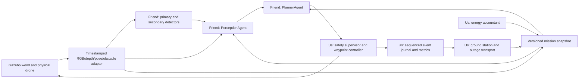

# SKYFORGE: 12-hour execution plan

Prepared 7 November 2026. Source of competition requirements: `../dronathon.pdf`, all three pages reviewed. User clarification: approximately **12 hours remain**, only the three dataset links were supplied, simulator/implementation choices are free, and **the friend owns all AI, including both agents and LangGraph**. Recommendations below are our engineering choices, not additional jury rules. Time spent researching/provisioning counts against the same deadline.

## 1. Outcome and scoring strategy

Build one repeatable, unattended humanitarian mission: explore, detect hazards and injured people, choose a medically appropriate feasible rescue, avoid danger, deliver supplies, continue through an outage, accept an objective update, synchronize records and land at base. Prove this with logs and independent checks, rather than only an attractive scene.

| Official scoring | Weight | What we should show |
|---|---:|---|
| Autonomy | 20% | One-command startup, no manual piloting, all mission states reached and logged |
| Decision intelligence | 20% | Farther critical casualty selected before nearby mild casualty; infeasible rescue rejected with reasons |
| Navigation | 15% | Safe camera coverage, wind recovery, obstacle/exclusion-aware path, moving obstacle stop/replan |
| Communication/resilience | 15% | Real packet outage while flight continues; sequenced events replay without duplicated deliveries |
| Adaptability | 15% | New objective, new obstacle and changed wind handled safely without reset |
| Global efficiency | 15% | Measured mission time, coverage, energy and end-to-end latency, with repeatability |

Penalties are not numerically specified. Treat collision, dangerous-zone entry, wrong-target delivery and failed return as high-priority failures. Raspberry Pi communication deployment is optional bonus and starts only after core acceptance tests pass. Waste/mines/weapons are detection/mapping tasks; the brief does not require waste collection. Injured-person rescue is the action priority.

## 2. Stack decision

**Selected: Ubuntu 24.04 WSL2 + ROS2 Jazzy + Gazebo Harmonic + Python 3.12 + deterministic LangGraph.** Use binary packages and one simulator. This ROS/Gazebo pairing is officially supported [R1]. ROS also addresses the PDF's Docker/ROS2 delivery wording without spending the event creating a second deployment stack. A Dockerfile can follow later if specifically required; it is not evidence of tested deployment until built and run.

The written brief says the jury provides a detector/world/station; the user reports only datasets and freedom. Build our own deployable scene/station and both vision adapters provisionally. Preserve an adapter boundary so jury assets can replace ours if supplied. Record this interpretation in the presentation and ask for clarification without halting independent work.

### Storage and performance

At the latest pre-install check: 15.64 GiB free on D:, about 5.6 GiB on C:. Existing Ubuntu's VHD is on C:. A **new WSL distribution named `Dronathon` is being provisioned under `D:\dronathon\runtime\ubuntu`**, using the official Ubuntu image selected through Microsoft's distribution manifest, with its SHA256 verified. Existing Ubuntu is retained.

The new distro's `/opt/skyforge` environment and Linux filesystem are physically backed by D:. Python environments, Gazebo packages and caches there avoid growing the existing Ubuntu disk on C:. Windows/WSL system memory and swap may still use C:; do not claim zero C: usage. Avoid moving the existing roughly 12 GiB distro onto the limited D: space. Keep dependencies, caches and large model files inside this D-backed distro or explicit D: folders. Source of truth stays `D:\dronathon`; Linux runtime/build output may use `/opt/skyforge` to reduce `/mnt/d` filesystem overhead.

Use ROS-base + ros_gz, not the entire desktop suite; no source build, Nav2 stack, Unreal/AirSim installation, Kubernetes or FreeRTOS. Preserve installed ArduPilot SITL as a tested backup/control option. It is not required by the PDF. Do not integrate a separate autopilot if Gazebo's own physical multicopter control satisfies the demo.

Start with Gazebo's `MulticopterVelocityControl` and rotor motor models [R2], wrapped by our waypoint and safety control. This controls simulated rotor dynamics; it is not a teleporting model. The controller's internal state source is simulator state; disclose that and confirm acceptance if the jury requires an estimator. Do not expose hidden target locations to the mission planner. If a compatible jury autopilot is later mandated, keep the same high-level command interface and replace the flight backend.

WSLg/DXG are present, but GPU rendering and achievable FPS must be tested. Compare actual render/AI load, do not assume the RTX 2050 beats the integrated GPU for the combined workload. Start with one 640x480 RGB stream, modest depth/obstacle sensors and a simple scene; disable expensive cosmetic effects. Keep the UI lightweight and record only selected frames. No local model training while testing full simulator latency if it contends for the same GPU.

### First technical gate

Within the first 60-90 minutes of implementation: launch Gazebo, read a timestamped camera and pose, take off/hover, move to one waypoint, return/land, then apply a small wind disturbance. Verify both ROS message exchange and rotor dynamics. A physics-only/no-camera success is insufficient for the vision handoff. If this fails, spend at most one focused debugging block before choosing a proven simulator sample; do not spend half the event fighting middleware.

## 3. Responsibility split

| Owner | Work | Boundary |
|---|---|---|
| Friend | Both detectors, dataset preparation/training, PerceptionAgent, 2D-to-3D localization, tracking/fusion, PlannerAgent, triage/global routes, deterministic LangGraph | `VisionSystem.infer(...)`, `MissionAI.step(snapshot)`; emits proposals and reasons |
| Us | Gazebo scene/drone/sensors, synthetic image/annotation generation, classic flight control and independent safety override, energy accountant, runtime scheduling, JSON station/outage/replay, metrics, integration, packaging and pitch | Supplies sensor snapshots; validates/executes AI proposals; returns completion events |
| Shared | Frame/coordinate contract, model thresholds versus camera altitude, urgency source, obstacle map visibility, latency interpretation | `../contracts/README.md` and revisioned config |

Friend's full copy/paste instructions: `AI_HANDOFF.md`. Integrate a mock immediately and replace it with real inference. No one changes class names, axes, timestamps or function signatures without updating fixtures. This task division is for the human teammate; no external messages have been sent.

## 4. Architecture



LangGraph coordinates the two friend-owned nodes. Compile a finite per-cycle graph once [R3]. Do not execute the whole mission in an unbounded graph invocation. Runtime and reflex control do not block on inference or station I/O. Workers exchange bounded latest-value snapshots; logs are written asynchronously. All state changes carry simulation time, input snapshot ID, map revision and goal revision.

Two loops plus background I/O:

- Reflex/control: target 50 Hz (20 ms period), process sensor health, imminent collision, local safe command and low-energy override. Requirement is <50 ms; period and compute latency are distinct measurements.
- Deliberation: target 10-20 Hz depending on measured load, only one graph decision in flight, discard superseded results. Measure <=100 ms decision duration and full <=150 ms p95 capture-to-command. A nominal loop frequency does not prove either.
- Background: networking/replay, metric aggregation, UI and recording. Bounded queues, explicit failure/overflow behavior, no synchronous cloud telemetry.

## 5. Minimal world that exercises the specification

Use a small configurable coastal patch, e.g. an **initial 60x40 m** area, then vary dimensions/layout/seed. These dimensions are project defaults, not jury constraints. Flat beach and shoreline/water boundary, base/delivery depot, fixed obstacles with real collision geometry, one moving obstacle, marine litter, passive mine/weapon props, multiple injured-person poses, and hostile-unit exclusion areas. Avoidance applies to zone geometry at all flight heights; flying over a dangerous zone is not an escape from the rule unless jury explicitly permits it.

One independent scenario/evaluation process controls wind, visibility, moving-obstacle motion and radio-shadow events. Do not move the drone or reveal hidden target coordinates to make a mission succeed. Fixed navigation aids/known geofence may be configured if permitted. Keep world generation seeds and scene assets versioned for reproducibility, and exercise additional seeds during validation.

Our synthetic-data generator runs in a distinct mode with labeled simulator cameras/supervisor metadata [R4]. Export clean RGB plus labels; annotation overlays are separate files and must never become training input. Runtime AI receives ordinary images/depth/navigation readings, not camera recognition ground truth. Asset IDs, full target manifests and evaluator positions stay outside the AI snapshot.

Medical urgency: the PDF does not provide how it is observed. Use an explicit scenario cue/authorized metadata channel and document it; do not invent an image-based medical diagnosis. If urgency is absent, mark unknown and use a declared conservative policy until clarified. Hostile role labels follow the agreed synthetic scenario, not demographic appearance.

## 6. Navigation, control and safety (our part)

Friend owns global planning. We supply a consistent observed map, navigation sensors, configured flight envelope and local obstacle measurements. A 2.5D safe-altitude map is a practical first implementation; its limitations must be explicit. The full 3D physics/camera scene is still required. Check tall obstacles and transitions; add height bands if a fixed altitude cannot safely navigate the scene.

Our waypoint controller converts world-frame target errors to bounded body-frame velocity/yaw commands; Gazebo's selected plugin expects body-frame velocities [R2]. Use the current orientation exactly once for that rotation. Limit speed, acceleration and vertical rates; verify settling/landing separately. A zero velocity command is hover/stop, **not disabled motors**. Never use the plugin enable=false as a normal emergency hover, because disabled rotor control can make the drone fall.

Safety supervisor validates every proposed segment against the latest obstacle and hazard map, including inflation by drone footprint, localization uncertainty, control tracking error and a time-dependent margin for moving obstacles. Use closest-approach/braking checks for local motion. Choose margins from stopping tests, not decorative values. If a route is unsafe, stop where safe and ask for replanning. A repulsive potential field alone is insufficient in concave traps or near zone boundaries.

On AI timeout, reject stale commands; hover/brake if safe and the wind/energy envelope allows it, else follow a previously validated return route under the same collision supervisor. Cache a safe return route continuously; if a moving obstruction blocks it, stop/replan or land at an explicitly permitted emergency site. Do not claim a guaranteed return when no feasible route exists. Log the failure honestly.

Wind must exert a physical disturbance, not only change a label in the UI. Use Gazebo WindEffects or an equivalent applied-force model [R5]; verify affected links enable the effect and demonstrate measurable drift without compensation. Stabilization/outer-loop correction should reduce this error. Bound the tested wind envelope; if safe progress becomes infeasible, trigger return/hold with an explanatory event.

## 7. Shared energy and medical-priority rules

Runtime owns energy accounting. Friend's planner calls/implements the same versioned route-energy estimator. Start with a transparent calibrated simulation model, e.g. `P = P_hover + k_air*|v_air|^2 + k_climb*max(vz,0)`; estimate coefficients from measured simulated mission segments or explicitly declare scenario parameters. This is an approximate **simulation** model, not a measured battery model for a physical drone. Integrate Wh using simulation timestep; paused simulation must not drain mission energy.

Use obstacle-avoiding route time and wind-adjusted speed/power. Straight-line distance and a fixed 20% trigger do not satisfy the dynamic-threshold requirement. Each cycle compute:

```text
E_return = estimate(current safe route to base, current wind/uncertainty)
E_threshold = E_return * (1 + model_margin_fraction) + E_landing + E_reserve
force RETOUR_BASE when E_remaining <= E_threshold

rescue feasible only if:
E_outbound + E_hover_delivery + E_return_after_rescue
  + E_uncertainty_margin + E_reserve <= E_remaining
```

Initial reserve/margins are config to calibrate, not official percentages. Latch the return transition to avoid oscillation. No normal station objective overrides a forced low-battery return.

Medical ranking belongs to friend: remove ineligible casualties, then rank urgency first, travel time second, stable ID third. Possible score: `urgency_rank + 0.49/(1+travel_time/t_ref)` for integer urgency classes, infeasible=0. Confirm jury's urgency/scoring interpretation. Waste reporting does not interrupt an urgent feasible medical delivery.

Delivery is a two-step request/completion protocol. Require fresh confirmed casualty location, correct target ID, supply availability, safe position/altitude, bounded horizontal error and stable low-speed hover for a configured dwell. Example starting values (to be validated): 1 m horizontal error and 1 s dwell; not jury values. Independent evaluator checks the actual delivery location. Mark served/decrement supplies once per unique completed delivery request.

## 8. Communication design (our part)

We build a small Python ground station unless a jury station arrives: compact status/map display, objective input, outage schedule and event-replay viewer. Do not spend hours on a complex web dashboard. Use a replaceable transport; initial local TCP with newline-delimited JSON is straightforward. Each line, including framing overhead, is <=999 UTF-8 bytes. A local file/mock is not evidence of radio-outage handling; actually disconnect/drop application traffic.

Envelope proposal: `v, mission, session, stream, seq, t_sim_ms, type, data`. Use separate monotonically sequenced streams for ephemeral status, durable mission events and commands. IDs include session so reconnect/reboot cannot collide. No images/full paths/full DroneState on the <1 KB station wire; transmit bounded summaries and chunk explicitly if required. Reject oversized/malformed/unknown-version messages.

Durable event stream: declare ring capacity 4096 events; persist pending event journal on disk; retain until acknowledged by contiguous event sequence. Use ack/replay negotiation with mission/session identifiers. Receiver de-duplicates by `(mission,session,stream,seq)`. Transport is at-least-once; idempotent handling provides one logical delivery/event effect. Live status is coalesced and not replayed as if it were critical history. Rate-limit replay and keep it off the flight thread. Detect capacity pressure before overflow; preserve an explicit gap record if storage really exhausts and report degraded integrity. Do not silently claim lossless replay beyond the declared outage/capacity envelope.

`goal_update` carries command ID and increasing goal revision. Acknowledge after validation and apply the newest valid objective at the next control scheduling opportunity; measure this delay. Treat immediately as bounded response, not zero time. Old graph outputs cannot overwrite the revision. Link loss changes communication mode, not mission goal or motor control: continue autonomy with buffered events.

## 9. Latency and resource proof

PDF limits: reflex <50 ms; decision <=100 ms; total <=150 ms at p95. It does not precisely define the start/end of total latency. Ask, but instrument conservatively from frame availability/capture to committed command as well as each stage. Report acquisition-to-command age including queue delay, preprocessing, **both** detectors, fusion/projection, graph planning, validation and publish. Include camera age; do not benchmark only cached graph calls and claim the full requirement.

Initial **engineering budgets**, to validate: camera wait/capture <=35 ms, preprocessing+combined inference <=40 ms, fusion+graph planning <=35 ms, serialization/control+publish <=15 ms, leaving 25 ms slack against 150. Stage p95 sums are only a budget, not mathematical proof of end-to-end p95. Actual end-to-end distribution is the acceptance evidence. If the two networks cannot fit, share preprocessing, reduce resolution carefully or use a measured compatible inference backend; never hide the slow model.

Use monotonic wall timestamps and trace IDs; use simulation time for mission dynamics. Record warm-up separately, count timeouts/dropped frames, include failures in the denominator, and report p50/p95/max for at least 1000 steady-state samples if time permits. Keep real-time factor and its variation visible; slowing simulation is not a way to claim wall-clock compliance. Stress with a radio replay, moving obstacle and both detectors active.

Model inference: ONNX CPU first for compatibility, CUDA/FP16 only when provider availability and output agreement are verified [R6]. RTX 2050 vendor/example timings are not measured results for our system. Avoid adding full CUDA/TensorRT toolchains just to pursue hypothetical speedups. Test 416/512/640 resolution versus small-object recall and total latency.

## 10. Twelve-hour work sequence

| Window | Us | Friend | Integration gate |
|---|---|---|---|
| H0-H1 | D-backed WSL/ROS/Gazebo; contracts; runnable drone sample | Audit datasets/access; AI package+mock; graph skeleton | Both teams run the same schema examples |
| H1-H2 | Hover/waypoint/land; camera/depth/pose adapter; first synthetic images | Medical ranking, energy feasibility, A* baseline; first model training | One proposal drives the simulated drone |
| H2-H4 | Coastal world, moving obstacle, real wind, energy model, synthetic labels | Initial primary and secondary models; projection/fusion/tracks | Camera detection -> target route -> physical delivery -> base |
| H4-H6 | JSON station, real outage, journal replay, goal update; independent evaluator | Integrate both models; improve missed casualties; graph timeout handling | Complete mission with outage and changed objective |
| H6-H8 | Collision/zone/energy tests; frame timing; tune physics/rendering | Freeze model/API; metrics and failures; fix frame/projection errors | Full stress scenario and two clean runs |
| H8-H10 | Five repeated scenarios, fix largest scored defect; package source/assets | Targeted AI fixes only; final model card/requirements | One-command startup on clean process, no internet |
| H10-H12 | Freeze code, rehearse, record backup video, document measured limits, pitch | Support demos and explain agent/vision evidence | Final two unattended demos; deliver complete archive |

If already past a checkpoint, integrate the smallest honest working version immediately. Do not keep a training experiment or infrastructure migration running while there is no end-to-end mission.

## 11. Acceptance scenarios

| Test | Required evidence | Primary ownership |
|---|---|---|
| Clean autonomous mission | Launch to landing, all states, correct aid target, no intervention | Us integration + friend graph |
| Medical priority | Far critical vs near mild, logged scores; urgent but infeasible third casualty rejected | Friend |
| Moving obstacle | Actual physical obstacle crosses path, safe stop/replan, no collision | Us controller + friend route |
| Hazard exclusion | Estimated zone persisted; route never enters; oracle evaluator independently checks | Friend perception/route + us evaluator |
| Wind change | Applied force, tracking error and recovery, energy threshold recomputed | Us + friend energy use |
| Radio outage 30-60 s | Autonomy continues, events retained/replayed, receiver duplicates=0 | Us |
| Objective change | Revision accepted, old proposal discarded, bounded reroute latency | Us transport + friend planner |
| Low battery | Forced return before rescue becomes infeasible; completion/landing reserve logged | Us supervisor + friend route |
| Stale camera/AI fault | No stale unchecked motion, logged fallback/timeout | Us |
| Unseen scene seed | Different layout/lighting, measured model recall and mission success | Shared |
| Performance load | Both networks+scene+network replay; p95 total and stage durations | Shared |
| Restart and offline | Exact versions/assets, no missing online model fetch, repeatable startup | Us packaging |

Use at least five complete mission trials if time permits. Report number attempted, successful and each failure category; do not drop failed runs. Full factorial weather/scene testing is unrealistic in 12 hours; choose meaningful combinations and state coverage limits. Detection accuracy is not mission success, and pixel mAP is not 3D delivery accuracy.

## 12. Deliverable layout and demo

```text
dronathon.pdf
docs/PROJECT_PLAN.md, AI_HANDOFF.md, RESEARCH.md
contracts/                      # versioned team APIs + fixtures
skyforge_ai/                    # friend-owned package, to arrive
sim/worlds/, sim/models/         # self-contained scene and physical models
runtime_adapter/, control/      # our sensors, reflex loop and safety supervisor
comms/, station/, energy/       # our infrastructure
evaluation/                     # independent oracle, trials and reports
config/mission.yaml             # units, margins, seeds and model config
scripts/launch_demo.sh           # final one-command demo, to be implemented
artifacts/                      # generated metrics, selected frames/video
```

This tree is the planned final layout; folders/scripts not already present are **not implemented**. Existing `src/coverage.py`, marker check and SITL heartbeat are preparation tools, not evidence that the full mission is solved.

Suggested short demonstration: autonomous startup, show camera detections, explain why the critical casualty is selected, cross an outage while rescue continues, introduce a goal update/moving obstacle, show replay integrity, then low-energy safe return/landing. Sequence changes must be scenario-scripted so the live drone needs no manual piloting. Keep independent failure counters, current mission phase, energy/return threshold and latency visible. Avoid a UI crowded with implementation jargon.

Pitch: humanitarian problem -> two-agent LangGraph architecture -> live mission -> measured autonomy/priority/resilience -> known limitations. Show 2-3 concrete numbers with denominators and evidence. Preserve a recording as presentation backup; do not substitute it for the mandatory live demo without disclosure.

## 13. Questions that materially change implementation

No questions have been sent to organizers. User/teammate can ask these while we build:

1. Since only datasets arrived, are the primary model, station and scenario now our responsibility, despite the PDF saying supplied?
2. Does ROS2-deployable source satisfy the delivery requirement, or must an actual Docker image also be demonstrated?
3. How is medical urgency provided/observed? What counts as successful delivery and its tolerance?
4. Are simulator navigation pose/depth and prior obstacle maps permitted? Hidden target labels remain excluded from runtime.
5. Does the 150 ms p95 include image capture and both networks? What is the exact timing method?
6. Which data split is authoritative, and what definition of detector accuracy is expected in addition to recall/mAP?

If answers do not arrive, record assumptions in config/docs and demonstrate the chosen interpretation honestly. Do not lose the critical path waiting for non-blocking clarifications.

References [R1-R8] and access limitations are in `RESEARCH.md`.
